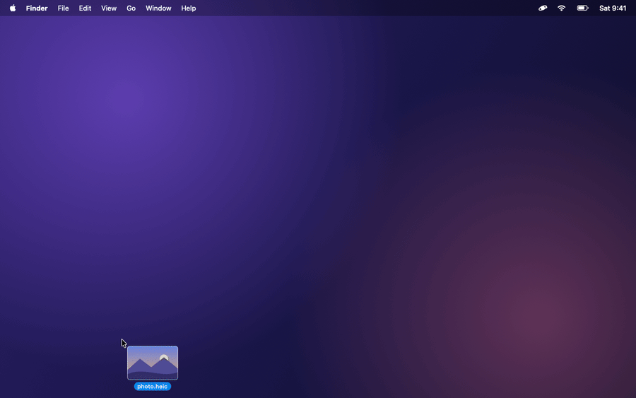
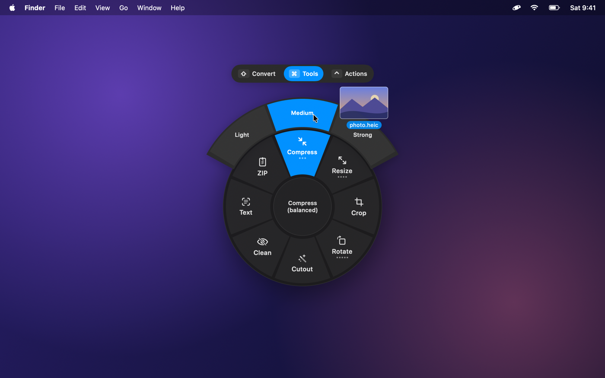

<p align="center"></p>

# Orbit

<p align="center"><b>Drag a file. Tap a key. Drop it on a format.</b></p>

<p align="center">
  <a href="https://github.com/dklingbeil/Orbit/releases/latest"><b>Download for Mac</b></a> · Apple silicon · macOS 13+
</p>

<p align="center"></p>

Orbit is a free, open-source file converter for macOS that lives in your menu bar. Start dragging any file, tap a modifier key, and a radial wheel appears under your pointer. Drop the file on a slice and the result appears next to the original. Everything runs locally and nothing is uploaded.

| Key | Wheel | What's on it |
| --- | --- | --- |
| ⇧ Shift | **Convert** | 479 source→target conversions across images, audio, video, PDF, documents, slides, spreadsheets, e-books, subtitles and archives |
| ⌘ Command | **Tools** | Compress, resize, crop, rotate, trim, split, merge, OCR, background removal, password-protect… |
| ⌃ Control | **Actions** | AirDrop, Float, Copy, Move, Copy Path, Terminal |

You can change the keys in Settings. The wheel stays open until you drop or cancel (drop on the center). While it's open, tap another key to switch wheels. Hover a slice with dots to see its options in an outer ring.

### Other ways in

- **Menu bar:** drag files onto the Orbit icon and the wheel opens beneath it, no key needed.
- **Keyboard:** select files in Finder and press **⌃⌥Space**. Use the arrow keys to move, ↑ for options, Tab to switch wheels, Return to run and Esc to cancel.
- **Finder:** right-click › Quick Actions › **Open in Orbit**.
- **Command line:** the `orbit` CLI exposes the same engine (see below).

## Formats

| Category | Reads | Writes |
| --- | --- | --- |
| Images | JPG, PNG, WebP, HEIC, TIFF, AVIF, BMP, GIF, SVG, PSD, ICO, camera RAW | JPG, PNG, WebP, HEIC, TIFF, AVIF, BMP, GIF, PDF |
| Audio | MP3, M4A, AAC, WAV, FLAC, OGG, Opus, AIFF, WMA, CAF | MP3, M4A, WAV, FLAC, OGG, Opus, AIFF, WMA |
| Video | MP4, MOV, MKV, WebM, AVI, WMV, FLV, MPEG, MTS, 3GP | MP4, MOV, MKV, WebM, AVI, WMV, GIF, plus any audio format |
| PDF | PDF (scanned pages are OCR'd) | DOCX, PPTX, XLSX, JPG, PNG, EPUB, TXT, Markdown, HTML, Pages¹ |
| Documents | DOCX, DOC, ODT, RTF, RTFD, Markdown, TXT, HTML, text clippings, Pages² | DOCX, PDF, Markdown, TXT, EPUB, HTML, RTF, Pages¹ |
| E-books | EPUB | DOCX, PDF, Markdown, TXT, HTML, RTF, Pages¹ |
| Slides | PPTX, PPT, ODP, Keynote³ | PDF, JPG, PNG, PPTX |
| Spreadsheets | XLSX, ODS, CSV, TSV, XLS³, Numbers³ | XLSX, ODS, CSV, TSV, PDF |
| Subtitles | SRT, VTT | SRT, VTT, TXT |
| Archives | ZIP, TAR, GZIP, RAR, 7z, TAR.BZ2, TAR.XZ, folders | ZIP, TAR, TAR.GZ |

¹ Needs Pages. ² Needs Pages or LibreOffice. ³ Needs LibreOffice or the matching iWork app.

Settings › Engines shows what your Mac can do right now. Anything unavailable appears dimmed on the wheel with the reason.

## Tools

- **Images:** Compress (Light/Medium/Strong), Resize (75/50/25% or custom), Crop, Rotate & Flip, Cutout (background removal, macOS 14+), Clean (strip location and camera metadata), Text (OCR), Combine into PDF
- **Video:** Compress, Trim, Crop, Rotate & Flip, Resize (1080p/720p/480p), Mute, Speed, Frame (still image), Split, Merge
- **Audio:** Trim, Compress, Normalize loudness, Speed, Fade, Split, Merge
- **PDF:** Compress, Split (every page or ranges), Merge (PDFs and images), Rotate, OCR (make searchable), Protect, Unlock
- **Other:** Shift subtitle timing, Extract archives, ZIP anything

<p align="center"></p>

Originals are never modified. Results go next to the original by default; you can pick Downloads, Desktop or another folder in Settings. If a name is taken, Orbit adds a number.

## Install

Orbit needs an Apple silicon Mac running macOS 13 Ventura or later.

1. Download the **.dmg** from the [latest release](https://github.com/dklingbeil/Orbit/releases/latest).
2. Open it and drag **Orbit** into **Applications**.
3. Open Orbit. The welcome window has a sample picture you can drag to try the wheel right away.

FFmpeg is bundled, so audio and video work without installing anything else.

> [!NOTE]
> Orbit isn't notarized by Apple yet, so macOS blocks it the first time you open it. Go to **System Settings › Privacy & Security** and click **Open Anyway**, or run this in Terminal:
>
> ```bash
> xattr -dr com.apple.quarantine /Applications/Orbit.app
> ```

### Build from source

```bash
brew install xcodegen ffmpeg
```

```bash
make run
```

`make run` generates the Xcode project from `project.yml`, builds Orbit in Debug and launches it. Development builds use the `ffmpeg` on your `PATH`. To bundle a self-contained static FFmpeg, as release builds do, first run:

```bash
make ffmpeg
```

Optional engines that unlock more formats:

```bash
brew install webp
```

```bash
brew install --cask libreoffice
```

Orbit needs **no Accessibility or Input Monitoring permission**. It may ask for:

- **Automation** permission, to read the Finder selection for the keyboard shortcut and to drive Pages, Keynote or Numbers
- **Notifications**, for long-running jobs

## Command line

```bash
make cli
```

```bash
Packages/OrbitKit/.build/release/orbit convert --to webp ~/Desktop/photo.heic
```

The CLI supports these commands:

- `orbit caps` shows detected engines.
- `orbit menu <files> [--tools]` lists what the wheel would offer.
- `orbit convert --to <format> <files…> [--out DIR]` converts files.
- `orbit tool <tool> [--option preset] [--text value] [--password pw] [--start s --end s] [--crop x,y,w,h] <files…>` runs a tool. `orbit tools` lists tool identifiers.

## How it works

```
App/                     macOS app (AppKit + SwiftUI, menu-bar agent)
  Input/DragMonitor        detects file drags system-wide + modifier taps
  Wheel/                   radial menu panel, hit-testing, keyboard control
  Jobs/                    job queue, progress HUD, notifications
  Actions/                 AirDrop, Float shelf, Copy, Move, Path, Terminal
  Editors/                 trim (AVKit), crop, prompts
Packages/OrbitKit/       the engine, usable without the app
  Core/                    formats, catalog (what converts to what), runner
  Media/                   FFmpeg-based audio & video
  Image/                   ImageIO, Vision OCR and background removal
  PDF/                     PDFKit rendering, text and table extraction, tools
  Documents/               Markdown, HTML, DOCX, EPUB, RTF ↔ a common document model
  Spreadsheets/            CSV, TSV, XLSX, ODS readers/writers, PDF rendering
  Office/                  ZIP container, PPTX writer, LibreOffice and iWork bridges
  Archives/, Subtitles/
```

**Drag detection.** A global mouse-down monitor starts a short polling loop. When the shared drag pasteboard changes and holds file URLs (or file promises from apps like Photos or Mail), Orbit watches the modifier keys. A clean tap of a configured key opens the wheel: press and release within 0.6 s with no other key involved. Keys already held when the drag began are ignored, so ⌥-dragging to copy in Finder keeps working.

**Engines.** Apple frameworks do most of the work: ImageIO, PDFKit, Vision, AVFoundation and the Cocoa text system. FFmpeg handles audio and video. DOCX, PPTX, XLSX, ODS and EPUB are read and written natively. LibreOffice, or Pages, Keynote and Numbers, is used only for formats that need a full office renderer.

## Development

```bash
make test
```

```bash
make smoke
```

`make test` runs the engine unit tests. `make smoke` generates sample files and runs every conversion and tool through the CLI.

The README visuals are rendered offscreen from the real wheel views. Regenerate them after UI changes with `scripts/make-promo.sh`.

Debug builds also accept `--demo-wheel <files> [--tools|--actions]` to open the wheel without dragging, plus `--welcome` and `--settings`.

## License

Orbit is released under the [MIT License](LICENSE). Release builds bundle FFmpeg, which is licensed separately under the LGPL/GPL; see [THIRD_PARTY_NOTICES.md](THIRD_PARTY_NOTICES.md).
